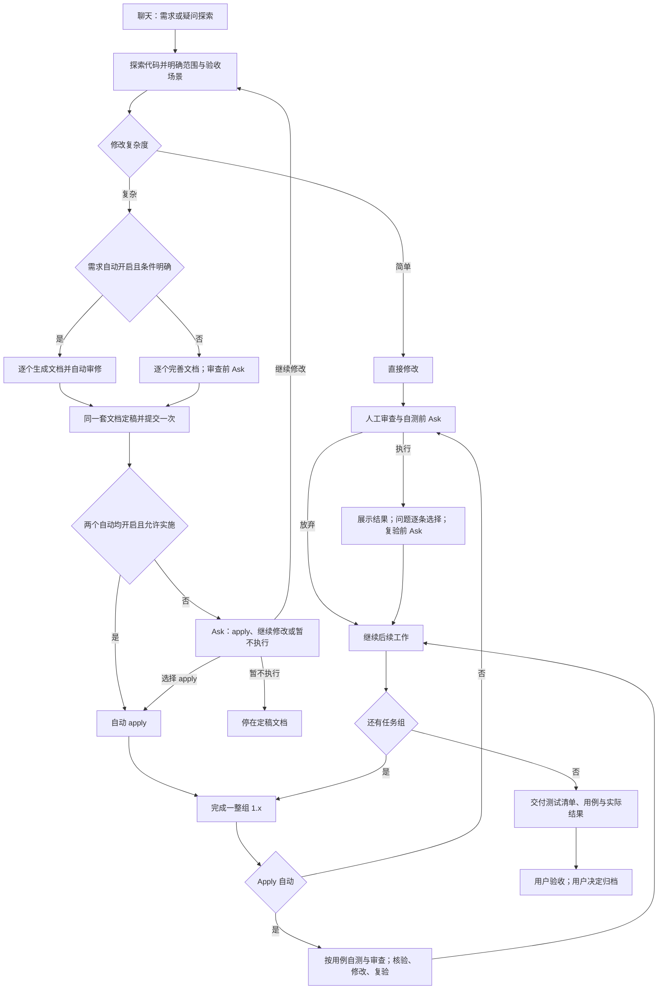
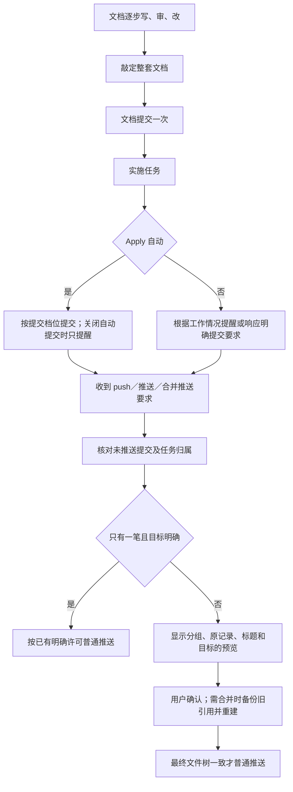

# 开发流程与检查边界

## 需求、实施与交付

探索时一起确定测试场景、需求差异和本次不做的内容。提案中区分用户要求、现状约束、实现细节和建议新增的业务行为；建议要等用户确认，不因打开全自动就自动扩需求。

实施必需的非敏感材料放在变更目录的 `assets/` 或 `references/`，随 Git 提交。四个产物不得依赖 `.vibe/tmp/` 或维护者的绝对路径。`workflow.js deliver --change <变更名>` 检查引用并生成相对链接的交付说明；`decisions.json` 的 `items` 可以记录类别、说明和用户是否已确认。它只汇总已有记录，不代替用户批准。

需求和 Apply 各有自动开关。需求自动先通过探索与澄清，逐个产物审修；同一套文档敲定提交一次。双自动且没有只写需求的限制时自动进入 apply，其余情况 Ask 提供执行 apply、继续修改、暂不执行。

tasks 只保存项目交付内容与验收标准，不强塞套件测试准备、联合验证、审查执行、起停服务或用户验收任务。实际交付的测试代码仍可作为任务。用例在需求和设计阶段准备，执行记录保存在本机，交付时提供清单、用例和实际结果。

需求自动条件由 workflow.js qualify 核对：传入当前会话、会话记录和 assessment 文件，包含 description、scope、acceptance、unresolved；未决问题先 Ask。任意阶段变更要同步所有受影响上下游产物、实现、用例和流程图，改处批注并记录业务理由。

每个文档产物和每整组 1.x 任务各有独立审查点。自动逐点核验、修改、复验；人工每次审查、自测、复验先 Ask。完整展示问题后逐条选推荐修改、不改或自行输入。用户放弃直接继续，不留下未审查或未测试待办。

## 验证、审查、提交

验证证据仅保存在本机，绑定项目、当前代码与环境指纹。失败、取消、后台启动和无法辨认的结果不能登记通过。代码、连接配置、本机环境变化后旧证据失效。IDEA 的文件检查只算检查，不当作构建或测试；只有明确完成的运行配置结果和实际终端验证才可登记。

默认审查方式是主会话准备材料，脚本向本机路由的独立审查角色发送有限请求。审查模型不能调用工具或自主搜索；材料包含开工基线差异、当前文件、需求与任务验法，提案审查可读提案明确点名的源码依据。敏感配置不进入材料，字面凭据遮掉。不能据此保证模型理解没有误差，意见仍由主会话核实。

| 设置 | 默认 | 边界 |
|---|---|---|
| `reviewExecutor` | `direct` | `agent` 仅用于人工整套提案／代码各一次；自动逐点固定 direct |
| `reviewBudgetSeconds` | 300 秒 | 每点每轮预算，范围 10 至 1800 秒；旧整套请求仍累计预算 |
| `reviewMaxFiles` | 20 个 | 范围 1 至 60 个；单文件和单批也有限额 |
| `contextStrategy` | `compact` | `handover` 才启用旧交接线提醒 |

```bash
node "$HOME/.claude/vibe-kit/tools/review.js" run --change <变更名> --mode code --point group-1
node "$HOME/.claude/vibe-kit/tools/review.js" status --change <变更名> --mode code --point group-1
node "$HOME/.claude/vibe-kit/tools/review.js" cancel --change <变更名> --mode code --point group-1
```

进度显示批次、覆盖文件和剩余预算。超时、取消、输入变化、格式不认识或部分覆盖不会记完整审查；交代已有结果与未覆盖范围，不自动无限重试。取消和中断仍占本轮，默认每点最多 3 轮，可设 1—20；到限仍有问题不能算通过。用户明确说“重新开启这个变更的审查预算”后才使用 `--new-budget`，该许可在启动时用掉，失败或取消也不能反复重用。兼容代理不能由套件脚本可靠地直接结束 Claude 内部任务；到点提示主会话只取消已登记任务，不再继续等待或新开替代代理。

处理文件形如 `{"findings":[{"id":"r1","action":"fixed","reason":"核实依据、修复位置和复验说明"}]}`，`action` 可为 `fixed` 或 `rejected`。用 `review.js resolve --change <变更名> --decisions <文件>` 登记，成立意见需要当前输入的成功复验。代码审查原始结论和处理记录都只留本机 `.vibe/reviews/`，可交付提案材料另放变更目录。

目录链接指向范围外、二进制或不可读材料会列为未覆盖。新的审查不继承上一轮意见处理状态；零问题报告或仅驳回意见不能批准后来改过的代码。

自动提交档位只在 Apply 自动生效，默认按任务，也可选阶段、整个变更或不自动提交；人工可提醒提交，提醒不代表自动提交许可。普通任务和提案先交代结果，等用户确认；纯审查轮次不单独提交。`workflow.js commit-plan` 列出仓库、指纹、已完成任务、验证、审查状态和开工前已有改动，计划不执行 Git。先确认改动归属，不能把同文件中原有改动整个带上。

用户说 push 就检测本地未推送提交，给出原记录、拟合并分组、最终标题和目标，再等用户看过后确认。同一具体任务或独立修复有确定编号才合并，需求与提案定稿、验收、归档保留节点，无依据的记录保留；含 merge、签名或版本标签时整段保留。预览绑定当前会话、仓库、分支、提交和远端地址指纹，成功后消费；新提交、目标变化、过期或取消后重新预览确认。默认用 Bash 或 PowerShell 运行套件工具，使完成钩子能核对实际计划；IDEA 终端也不能跳过预览。

## 环境、服务、恢复和上报

本机环境页可检查项目就绪：识别构建文件，核对工具、依赖目录和登记的驱动文件；标明尚未实际构建、版本兼容和索引就绪尚未验证。不会为检查跑项目脚本、下载依赖或连接数据库。

自动探索的连接从开发环境来源消失后撤回自动生成项，来源暂时不可读则禁用；人工连接不擅自删除。退役记录只留连接名、来源文件和原因，无地址和口令。数据库后台执行器发现配置指纹改变后关闭旧连接池；请求携带的指纹不匹配就拒绝，不能继续查旧库。

起前后端时使用 `devserver.js start --name frontend --port auto --avoid <项目端口> --backend backend -- <命令>`。后端要有有效服务记录；前端收到 `VIBE_BACKEND_URL`、`VITE_BACKEND_URL`、`BACKEND_URL`。项目代理需要读取环境变量，套件不自动改业务配置，也不保证写死的代理能连通。`scenario-run.js <场景> --service frontend --project <目录>` 使用登记的实际地址。自测说明显示服务地址、验证结果和等用户确认的任务；进程存活不等于接口健康。

连续工作默认优先 Claude Code 自动压缩，不自动写交接或执行 clear。交接技能和直接编辑交接文件都需要当前用户明确要求。压缩和恢复时核对分支、当前任务、服务、验证与审查事实。历史交接只有用户明确点名才提示读取，阅读历史不恢复旧许可。旧 `autoHandover` 值保留，压缩优先策略下不触发；旧 `autoResume` 开关 2026-10-17 删掉了；用户选择旧交接策略时才按该策略的开关执行。

同一变更有多个实施会话时提示冲突，取消、退出、过期和归档会撤回记录；这是提醒，不会隔离工作区。状态更新使用跨进程锁和原子替换，活进程持锁不会仅因时间久被抢走。

更新前保留受管代码的本地恢复包，逐文件校验哈希后才执行恢复；不含用户状态、模型配置、凭据、业务数据库配置或 JDBC 驱动。损坏恢复包被拒绝，仍保留原来的远端退回方案。升级自检同时检查基础行为入口。

诊断输出、问题反馈、路由错误与 IDEA 完成输出遮盖凭据；正常模型正文保持原样。IDEA 输出替换只影响送入模型的完成结果，不能撤回 IDE 已写的文件或外部遥测。只有识别出的 IDEA 工具采用适配，未适配工具继续走原保护。

读取缓存只在一次钩子调用内复用，不跨会话或下次请求。耗时保存在本机，本机环境页可看；上报只增加成功、失败、超时等次数，不传代码、路径、提示词、提交信息或耗时。新使用情况用持久随机设备标识分组，不传原电脑名；升级更新旧议题标题与固定表格，保留历史补充和人工说明。真实网关上的时间与 token 收益仍需现场测量。

## 执行流程



## 提交与推送


