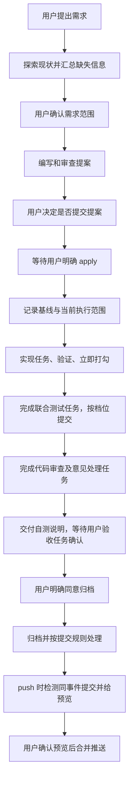

# vibe-kit 开发流程优化方案

建议按“流程可靠性、验证与审查、开发协作、运行效率”分批推进。先修复授权、连接和状态问题，并停止凭旧交接记录恢复任务；随后增加审查的总预算和替代执行方式。连续工作以自动压缩为主，各环节共享可核对的执行证据，把用户确认留在真正需要决定的节点。

**方案依据与状态**

| 项目 | 内容 |
|---|---|
| 日期 | 2026-10-11 |
| 当前套件版本 | 20261010.2210 |
| 源码依据 | `856c6d508d6845a0b6334ac03e7408528bd2e5b5` |
| 关联审查 | [中立审查报告](../reviews/20261011-vibe-kit-neutral-review.md) |
| 当前状态 | 用户已授权实施，产品代码与专项测试已更新；最终回归和安装包验收见[实施记录](20261011-implementation-progress.md) |
| 已验证的依据 | 上轮五类缺陷的边界复现、六组专项测试及钩子耗时小样本 |
| 本轮新增工作 | 核对完整开发流程、验证判断、审查材料、提交时机、项目探索、服务管理及 IDEA 入口；补充审查长期无结果、旧交接误恢复，以及测试和代码审查纳入 tasks 的反馈 |
| 追加反馈的证据边界 | 源码确认审查缺少任务级限时收尾、旧交接仍有自动读取提示；未取得那次慢审查的脱敏执行记录，具体耗时原因尚未定位 |
| 当前用户偏好 | 连续工作主要使用原生自动压缩，历史交接不能凭一句“继续”被自动接上；审查需要可见进度、截止时间和非子代理方式；测试与代码审查也作为可验收任务，完成即打勾 |
| 收益的证据等级 | 缺陷已有复现；流程优化来自源码与规则分析，实际耗时、请求和 token 收益待实施后测量 |

**当前能力与需要补的环节**

套件已经具备项目探索、任务验法、页面场景、审查、按档位提交、服务管理、IDEA MCP 适配和反馈收集。下面的方案尽量扩展这些能力。

| 开发环节 | 已有能力 | 优化重点 |
|---|---|---|
| 进入项目 | 后台探索工程和配置，生成项目说明 | 提供简短的环境就绪结果，区分“检测得到”与“实际可用” |
| 需求与探索 | 要先探索、确认范围，新增操作需说明 | 分清用户要求、现状约束与建议，提前规划测试和审查任务，避免扩大需求 |
| 提案交付 | 四类产物检查，实施材料检查 | 给出差异摘要和交接清单，使另一人能接着 apply |
| apply | 会话阶段、任务打勾和验证检查 | 明确许可、记录开工基线、跨入口采集执行结果 |
| 验证 | 从会话中匹配成功命令和场景 | 保存范围明确且与当前代码匹配的验证证据 |
| 审查 | 提案、代码分别审查，文件与命令限额 | 自动整理材料，提供有总预算的独立模型审查，显示覆盖与超时结果 |
| 提交 | 四档自动提交，普通任务先问，合并 push 工具 | 用提交计划分离打勾、提交、开工和推送许可 |
| 自测归档 | 用户自测后明确同意才能归档 | 生成实际可执行的自测说明，并使验收失效条件可见 |
| 中断与接手 | 提醒原指令，按开关交接，启动时提示旧记录 | 自动压缩保持连续工作，旧交接仅明确选择后读取，恢复前核对真实任务与许可 |
| 更新与维护 | 暂存、自检、回退、问题和用量上报 | 本地恢复、入口自检、匿名指标与规则失效标记 |

主要源码依据：[session.js](../../vibe-kit/kit/lib/session.js)、[guard-spec.js](../../vibe-kit/kit/hooks/guard-spec.js)、[verify-gate.js](../../vibe-kit/kit/hooks/verify-gate.js)、[onboard.js](../../vibe-kit/kit/lib/onboard.js)、[devserver.js](../../vibe-kit/kit/tools/devserver.js)、[idea-tools.js](../../vibe-kit/kit/lib/idea-tools.js)。

## 统一行为与优化内容

**目标流程**



普通修复、配置和文案任务按当前分类直接实施，验证后汇总结果，用户同意才提交。它们不因项目里存在历史变更而进入全自动流程。

**许可与业务状态的关系**

| 节点 | 模型和脚本负责什么 | 用户决定什么 |
|---|---|---|
| 探索 | 查现状、给证据、合并需要问的信息 | 需求范围及新增业务行为 |
| 提案 | 写产物、审查、修正、列出差异 | 是否提交提案 |
| 开工 | 检查提案及当前环境，说明全自动是否生效 | 是否开始当前变更的 apply |
| 实施 | 按任务验证并立即打勾，按所选档位提交 | “我说了才提交”档位中的提交许可；既有数据操作确认 |
| 自测 | 给实际地址、步骤、预期结果和未验证项 | 自测是否满意、还要修改什么 |
| 归档 | 检查任务、审查和验收依据，执行归档 | 是否归档当前变更 |
| 推送 | 检测未推送提交，列出同事件分组、最终标题和目标 | 看过预览后是否按计划合并推送 |

提交提案、开始 apply、归档、普通 push、合并 push 是分别授权的操作。继续实现时无需重复确认已经授权且范围未变化的动作。跨会话接手、范围扩大和用户撤销都要重新核对许可。

**O01：统一阶段与用户许可，修复 R1、R2**

当前摩擦：多个钩子各自推断阶段，公共的词匹配又把否定和讨论识别成执行。只修一个正则仍容易漏掉技能、提问框和 MCP 入口。

拟做：

- 抽出共同的用户意图判断：明确执行、讨论、否定、延后、撤销、范围修改。确定性规则无法辨明时，保持原阶段并合并需要澄清的信息。
- 否定、延后和撤销优先于操作词命中；明确暂停后停止启动新的实施步骤，并核对已经运行的后台工作。对话里提到 apply 本身不能授予开工许可。
- 正常业务许可绑定操作、当前变更或普通任务范围、仓库、来源用户消息。提问框中的真实答案和直接命令进入同一判断。
- 将阶段展示与执行许可分开。模型自己调用技能、日志出现操作名，都不能创建用户许可。
- 许可在对应操作成功后消费；失败重试保留相同对象和范围的许可；目标变化、用户撤销和跨会话接手重新核对。
- 自测与归档许可绑定本次交付的代码版本，包含已提交和未提交输入的指纹；自测后又改了代码，旧验收不能批准新版归档。
- 状态栏和开工提示从同一结果生成，显示当前阶段、全自动是否实际生效、当前等待谁。

验收：上轮全部否定和话题词复现转为正确行为；明确 apply、提交、归档仍正常；提案提交不授予 apply；首次 push 只启动检测，预览后的真人确认才批准合并历史；全自动遵守提交档位。覆盖命令、HTTP、技能和 IDEA 路由工具，以及中途取消、换变更和跨会话接手。

收益：减少擅自开工、误提交和误归档；让使用者知道下一步为何在等待。

**O02：管理连接从可用到不可用的变化，修复 R3**

当前已有开发环境筛选、多版本驱动和项目归属判断。需要补旧连接的有效性。

拟做：自动管理连接明确分为开发可用、已判非开发、来源缺失、来源暂时读失败；列表、解析器、后台数据库进程和 Redis 都遵守同一判断。明确非开发的连接移出可执行列表，保留可恢复的隔离记录；人工配置由用户维护。

连接的有效性或驱动选择变化后，清理对应后台进程的旧连接缓存。展示驱动选择依据和歧义，避免仅显示一个最终版本。只显示必要的非敏感判断信息。

验收：开发切非开发、文件暂时不可读、连接删除再恢复、人工改动、驱动版本缺失或歧义均有测试；已停用连接在新进程和旧后台进程中都不可选。验证列表及错误输出不附带口令。

**O03：统一错误与日志脱敏，修复 R4**

拟做：路由、诊断接口、模型错误响应、IDEA 输出适配和反馈出口共用脱敏契约。先替换已配置秘密的精确值，再遮敏感字段，最后截断。正常模型内容与错误诊断分开处理，防止诊断格式调整破坏流式协议。

验收：假 key、假口令在 JSON 错误、纯文本错误、流内错误、日志、统计、UI 和客户端错误中均不可见；合法错误分类和恢复提示保留。测试凭据只用假值。

**O04：可靠写状态与会话协作，修复 R5**

第一步为同一状态文件的读改写增加跨进程排他更新，采用 Node 自带模块。锁按状态文件划分，包含归属与恢复依据；处理更新失败、进程退出和崩溃。成功结果必须意味着记录确实保留。

同步验证更新器“检查后写锁”的竞争窗口。新的授权、证据和计数模块都使用这个基础能力。

第二步增加会话冲突提示：同一子项目同一变更的多个实施会话能看到冲突；读代码和检索会话照常工作。冲突提示在有确定证据时触发，恢复时核对实际进程和会话记录，避免留下永久占用标记。文件归属仍要通过 Git 和实际改动核对，标记不代表工作区被隔离。

验收：两个并发独立更新全部保留；锁持有者崩溃可恢复；更新并发不能同时安装；同一会话重试不重复记数；不同项目不串数据。基础错误继续按既定 fail-open 处理并显示检查降级。

**O05：给出环境就绪结果，减少开工后才发现缺环境**

当前后台探索会生成命令和端口，但不实际运行构建或连接数据库。套件应区分“识别出 Maven”与“当前 JDK、Maven 和依赖可完成验证”。

拟做只读的项目就绪检查，复用 `onboard`、驱动登记和 IDEA 连接探测。会话开始给简短摘要；配置页给详细结果；环境未变化时复用结果。

| 项目 | 拟检查内容 |
|---|---|
| 工程 | 壳子、子项目、OpenSpec 位置和实际操作目录 |
| 工具 | 项目需要的运行时、构建工具、系统浏览器及版本兼容性 |
| 验法 | 项目说明中的命令是否存在、当前适用范围和检测依据 |
| IDEA | 已连接、工具可用、索引就绪情况或不可用原因 |
| 数据库 | 开发连接有效性、驱动解析结果；检测默认不主动连接 |
| 服务 | 所需服务、项目端口、套件端口、代理关系和所有权 |

检测不自动跑项目脚本、联网拉依赖或修改用户配置。进入具体已授权任务后，再执行它需要的构建和准备工作。事实记录带来源指纹，项目配置、工具版本或人工说明变化时失效。

验收：新电脑、缺 JDK、离线缺依赖、IDEA 未启动、代理写死、驱动缺版本都能准确说明；用户改过的项目说明保留；已有结果不能冒充本次构建成功。

**O06：需求差异摘要、测试与审查任务、可交接的提案**

在探索结果和提案收尾中，增加简短的差异表，复用现有 `proposal`、`design` 和 `revisions`，由用户一次核对需要决定的内容。

| 类别 | 写法与处理 |
|---|---|
| 用户明确要求 | 写明对应要求，不增加业务含义 |
| 已有代码或环境约束 | 列来源与影响，例如真实接口参数、数据库字段 |
| 实现细节 | 给出理由，保持在已确认需求范围内 |
| 新增业务行为 | 删除数据、增加角色、增加接口或改变流程等单列，需用户确认 |
| 本次不做 | 写原因及影响，体现到规格和任务中 |

脚本核对这些决策项是否在四类产物中一致；语义是否合理仍由用户和审查者判断。不要为满足场景数或禁用模糊词的检查，编造额外功能。

提案交付清单包含四类产物、必要材料、依赖版本、验法、已确认与未确认决策。已存在的 `proposal-files.js` 继续检查临时引用；新增“换一台电脑可读取”的交付验收，覆盖 Git 忽略、未纳入提交的资产和固定版本外部材料。

实现必需的非敏感材料放在变更的 `assets/`，本机日志和口令留在本机。合适的场景、脚本经检查后进入项目已有测试目录，使团队能重复运行；已有 `.vibe/scenarios/` 继续作为本机场景来源。

**测试和代码审查纳入 tasks**

推荐从探索时就规划测试范围、必要用例、验证环境和审查范围；在提案的 `tasks.md` 中形成实施清单。探索与提案阶段仍与用户沟通，列任务不代表开始执行。测试场景以规格为依据，tasks 引用场景与测试文件，不重复抄写整份 WHEN、THEN，也不为了测试清单增添用户未要求的业务行为。

任务按依赖组织，保留普通复选框与编号格式，通过明确分组或轻量类型标记区分职责，不能仅因任务名称含“审查”二字就改变执行阶段。

| 任务类别 | 写进清单的内容 | 打勾条件 |
|---|---|---|
| 测试准备 | 必要的测试用例或脚本、对应规格场景、测试输入和环境 | 用例已交付且可执行，覆盖约定范围；与后续“测试通过”分别判断 |
| 实现 | 功能改动、影响文件和本项验法 | 本项实现及验法通过，立即勾；保留现有做完一项验一项的要求 |
| 联合验证 | 必要的集成、回归、接口与页面验证 | 相应测试成功完成、实际结果符合预期，有当前输入对应的证据 |
| 独立代码审查 | 变更范围、开工基线、审查方式与覆盖要求 | 收到完整审查结论且覆盖约定范围；可以发现问题，但已启动、超时或只审部分都不算完成 |
| 审查意见处理 | 成立问题修复、驳回理由、必要复验与规定复审 | 成立问题处理并复验通过，其他意见理由明确，规定轮次收尾；无问题时记录该任务无需修复的依据 |
| 用户验收 | 自测入口、步骤、预期结果和待确认点 | 用户明确确认本次交付满意；助手测试通过不能代替用户验收 |

示例是拟采用的任务结构，具体路径与命令应来自项目探索结果：

```markdown
## 1. 测试准备
- [ ] 1.1 编写订单校验用例：tests/order.test.js；验：覆盖 specs/order/spec.md 中约定的正常与异常场景，用例可被测试工具发现并执行。

## 2. 实现
- [ ] 2.1 实现订单校验：src/order.js；验：对应订单校验单测通过。

## 3. 联合验证
- [ ] 3.1 执行订单相关回归：tests/order.test.js；验：指定回归命令成功，实际输出符合预期。

## 4. 代码审查
- [ ] 4.1 完成独立代码审查：src/order.js、tests/order.test.js；验：取得绑定本次代码的完整结论，范围覆盖全部相关差异。
- [ ] 4.2 处理审查意见：src/order.js、revisions.md；验：成立问题已修复并复验，其他意见记录理由，规定复审完成；没有问题时记录无需修复的结论。

## 5. 用户验收
- [ ] 5.1 用户自测验收：specs/order/spec.md；验：用户按交付说明自测后明确确认满意。（留给用户：自测确认）
```

测试准备与实现的顺序按依赖调整。编写测试的任务可以验证用例被正确发现，尚未实现的功能导致用例失败应明确记录；这不等于回归任务已经通过。独立测试任务不取消实现任务的本项验法，已覆盖相同输入的有效证据可由 O07 复用，避免为了勾两项机械重跑。

提案审查仍是 apply 的前置条件，在提案收尾清单展示；不能把它作为必须先 apply 才能完成的任务。归档属于用户确认后的操作，不能放进“全部打勾才允许归档”的实施任务中形成循环。用户验收任务未完成时，全自动完成其余任务后交付自测说明并等待，不代用户勾选，也不为了全勾将其标为不做。

新任务结构沿用原有提交档位和即时打勾规则。完成任务与产生提交分别判断，审查本身不能变成每一轮都提交一次的理由。普通任务仍遵守用户确认提交的规则。

验收：另一份干净 checkout 能读取全部实施输入；没有真实数据、口令和本机路径依赖；用户未确认的业务行为不能被标成已同意；测试与审查任务在探索时可核对、apply 后按依赖执行；失败、超时、未完整覆盖和未得到用户确认的任务不勾；正常和全自动均不靠默认方案扩大业务范围。

**O07：记录和复用验证证据，减少重复编译与误判**

当前 `guard-spec.tickCheck()` 和收工检查主要回看会话里的命令与成功结果，部分匹配依赖工具名。这种兼容逻辑有价值，但验法与运行证据结合得不够明确，长会话和 MCP 入口也增加回溯难度。

拟建立本机验证证据，供打勾、提交、审查和收工共用。采用工具完成后的结果采集与已知验证执行器相结合的方式。Claude 官方提供 `PostToolUse` 的输入和响应字段；不同 CLI 版本与工具响应形状需通过假网关探针核对。[官方钩子说明](https://code.claude.com/docs/en/hooks)

| 证据字段 | 用途 |
|---|---|
| 仓库、变更、任务或场景 | 判断对应哪个工作对象 |
| 验证类别与必要的非敏感参数 | 区分编译、单测、接口、页面和检查脚本 |
| 成功、失败、尚未结束 | 后台命令已启动不能视为已验证 |
| 当前代码与验证输入的指纹 | 修改后判断旧证据是否仍有效 |
| 项目配置、依赖、工具和运行环境 | 防止换 JDK、换库、换环境后复用旧结果 |
| 工具调用编号与证据来源 | 去重、追溯和兼容旧版本 |
| 耗时、完成时间和摘要 | 本机排障与优化测量 |

规则：同一验证覆盖范围内，代码、场景、配置和依赖均未变化才复用。无法证明范围完整时重新验证。人工验收、编译成功、接口行为和页面行为分别记录，不能互相替代。每项任务验证满足即刻打勾。

例如后端编译成功后，下一项只更新提案说明，可以继续使用该编译证据；再改后端源码就必须重新编译。涉及共享模块、依赖和配置变化时扩大验证范围。

已有工具回看逻辑保留为旧版本兼容入口；新采集器只处理相关工具，结果缺字段时不伪造成功。证据保留元数据，不新增全量工具输出、SQL 或业务数据归档。

测试任务凭对应命令或场景的真实成功结果打勾，审查任务凭 O08 的完整审查记录打勾，用户验收凭 O01 的明确用户确认打勾。各自识别结果类型，不能借一个成功的 Shell 命令给审查或人工验收作证。只因任务勾选状态改变，不应使验证证据失效；代码、用例、验法和适用环境改变时，重新判断受影响范围，并使相关已完成项显示需复验。

验收：正常命令、PowerShell、IDEA 编译、页面场景、后台完成和失败结果均归一；错误目录中的同名命令不能作证；改源码后证据失效；单纯提交或更新勾选不失效；测试、审查与用户验收不能互相冒充；压缩或中断后仍能核对。证明复用范围正确后，再测重复验证是否减少。

**O08：有总预算的独立审查，自动整理材料并显示覆盖范围**

用户反馈开发耗时约一刻钟，审查运行约一小时仍无结果。这种等待应有明确的异常收尾。开发时间不能直接决定审查时间，但审查也不能因一直等待后台通知而无限占用流程。

当前源码的限制与缺口：

- [审查技能](../../vibe-kit/claude/skills/ttls-cross-review/SKILL.md)要求等结果再继续，后台审查未完成时不另起一轮。
- [审查代理](../../vibe-kit/claude/agents/ttls-reviewer.md)通过提示限制读取文件和命令数量，禁止重复编译、测试及起服务。这些不是执行器强制的总耗时限制。
- [verify-gate.js](../../vibe-kit/kit/hooks/verify-gate.js)当前在全部 tasks 打勾后才催代码审查，不能直接塞入一个未完成的“代码审查”任务；[guard-spec.js](../../vibe-kit/kit/hooks/guard-spec.js)当前打勾验法主要匹配成功命令，也需补审查记录和用户确认的类型判断。
- [pendingReviewsIn](../../vibe-kit/kit/lib/session.js)超过三十分钟不再将部分旧调用列为待完成，但不会取消代理、产生超时结果或结束未完成轮次。
- [路由](../../vibe-kit/router/router.js)的首字节与流空闲超时针对单次请求，不能约束整个审查中的多次请求、工具等待和重试。当前平均审查耗时主要取自已完成记录，长期未完成的任务还需单独计数。

慢在网关排队、模型生成、工具、反复补材料，还是结果通知与记账，需要按实际执行记录区分。本轮未取得该次审查的脱敏记录，不能认定某一环节就是原因。官方也说明子代理有独立上下文和自己的请求，重新收集材料需要时间，因此使用子代理本身不保证更快。[官方子代理说明](https://code.claude.com/docs/en/sub-agents)

拟先准备可核对的材料：

- apply 前记录壳子与各相关子项目的 HEAD、已有工作区改动和提案指纹，保留用户原有改动的归属边界。
- 审查前从基线与当前状态生成材料：已提交差异、未提交差异、新文件、任务与需求对应项、有效验证摘要和已知风险。
- 本机确定性检查先运行，只把语义判断和未解决项交给模型；验证结果直接复用，审查不重跑构建。
- 材料按业务模块排序，直接关联的接口、共享代码和配置纳入范围。记录材料版本、已经审过和未审范围，材料变化后显示需要复核的影响集。
- 审查修复仍按当前单轮或多轮配置执行；复审材料以原问题和修复差异为起点，必要的连带上下文保留。

**审查方式比较与推荐**

| 方式 | 适用情况 | 取舍 |
|---|---|---|
| 本机脚本检查 | 路径、产物一致性、Git、格式及已有静态规则 | 快且可重复，语义和业务正确性仍需模型或人判断 |
| 主会话按检查清单自审 | 小改动快速核对、独立审查前准备 | 已有上下文可复用，但仍受原思路影响，不能冒充已完成独立审查 |
| 本机执行器向另一个模型提交只读材料 | 提案与代码的常规独立审查，推荐路线 | 保留独立模型判断，限制请求和补材料范围；效果及耗时需要实测 |
| 限范围子代理 | 材料不足、确有必要自行检索的审查 | 保留为可选方式，必须有总预算、取消与覆盖记录 |

推荐新增采用 Node 自带模块的审查执行器，复用现有路由的审查角色和认证协议。它把材料交给另一个模型，使用独立上下文，不附带写作者的思考过程；路由持有凭据，执行器与模型不读取 `router-data/config.json`。实际模型映射相同时，不能宣称已经“换模型”。该路线是套件的拟新增能力。

常规材料完整时由一次受控请求完成。缺少上下文时模型返回结构化缺口，执行器只补允许范围内的非敏感材料；不授予模型任意 Shell、写文件、重新构建或无限检索的能力。大材料按模块拆分，保留总预算及未覆盖清单，不能静默截断后报全审完。材料中的代码、注释与文档作为待审数据，不能变成执行指令。

执行器输出已审范围、未审范围、问题与证据，以及完成、不完整、超时或取消状态，再适配现有审查记账。问题为零与完成状态分别判断。现有每个变更的提案、代码独立审查及轮次规则保留；换执行载体不取消独立审查，也不增加一组并行代理。

**按任务依赖触发，不等全部 tasks 勾完**

O06 的实现和必要测试任务完成后，代码审查任务即可执行；审查处理任务与用户验收不作为首次审查的前置条件。同一调用既给出审查记录，也支持对应审查任务打勾，旧收工提醒识别已经启动或完成的任务，避免再催一遍。

审查完成与问题处理完成分别记录。收到完整结果后勾审查执行项；成立问题修复、复验和规定复审完成后勾意见处理项。修复如果改变审查输入，按影响集更新测试与复审状态，不把上一份结论当成修复后全部代码已审。仅更新复选框与结果引用不应反过来令同一审查失效，审查基线应排除这些进度字段，并保留任务内容和验法的有效变更判断。

全自动只执行当前 apply 已授权范围内的实现、测试及审查任务，遇到新业务行为或需要用户操作的事项继续遵守原确认规则。阶段统计、状态栏、归档检查、提交计划和后台通知都从同一任务分类与依赖结果读取。旧任务没有类型时保留当前兼容入口，不给已有变更盲目追加任务或代打勾。

**建议的等待策略，数值待受控项目验证**

| 条件 | 建议值 | 拟行为 |
|---|---|---|
| 无可核对的进展 | 2 分钟 | 显示当前阶段及已用时间，区分正常等待和可诊断异常 |
| 常规审查仍未结束 | 3 分钟 | 显示等待模型、读取材料或补充材料，以及已审和未审范围 |
| 常规审查总预算 | 10 分钟 | 包括排队、请求、工具与重试；达到上限结束本轮并报告未完成部分 |
| 可恢复错误自动重试 | 最多 1 次 | 计入原总预算；不可恢复错误直接收尾，不能每重试一次重置时钟 |

这是控制等待的建议，不承诺所有审查都能在预算内完成。大型变更先给出范围和预算，再按明确范围分批。显示状态主要读取本机记录，不能为了报进度不断调用模型；收到心跳或少量字节不等于已审范围增加。

新执行器达到截止时间时关闭本次请求，并验证路由能中止关联下游请求。旧子代理仅通过对应 CLI 正式支持的任务取消方式结束；不能为取消审查杀主会话或共享路由。若某版本不能可靠取消，要标明仍可能运行的旧任务，不自动叠加第二个任务。迟到结果绑定调用编号和材料指纹，失效调用不能重新把本轮记为通过。

超时和通知丢失都返回主流程的明确结果，保留部分发现及未审范围。停止无限等待，不将超时算作问题零条，不让未完成审查批准归档。程序异常仍遵守钩子 fail-open，并显示检查降级，不能伪造成功记录。

验收：审查任务未勾时正常启动，用户验收未勾不阻止审查；后台启动不勾，完整结果才勾，问题处理另行验收；纯进度勾选不重复触发审查；改代码后按影响复审；按任务频繁提交后仍覆盖整次变更；多仓库、新文件、用户原有改动与大变更缺口都可见；假网关排队、流持续但无结论、工具卡住、重试、通知丢失和迟到结果均能正确收尾；取消不影响主会话；重复触发不产生重叠任务；单轮与多轮记账一致；输入及诊断不夹带秘密。对比三种模型审查方式的耗时、请求、覆盖与成立问题，不只比较速度。

**O09：生成提交计划，保留细致历史并减少提交时机混乱**

采用最新决定：提案审修结束后单独询问是否提交；提交和 apply 分开。默认按任务提交继续生效。阶段、变更和“我说了才提交”档位均保留。

拟由脚本根据任务、当前改动和审查状态生成提交计划，包含仓库、文件或改动段、主题、验证依据、何时满足提交条件。调用方执行前再核对计划是否过期。

| 场景 | 拟行为 |
|---|---|
| 提案审修完成 | 汇总产物并询问是否提交；提交后仍等用户 apply |
| task 档位 | 本项验证并打勾后提交，本次提交只含相关改动 |
| phase 档位 | 每项仍立即打勾，同一大编号完成后提交 |
| change 档位 | 打勾照常，完成变更与审查后提交 |
| off 档位 | 达到可提交状态后汇总，等待用户同意，全自动也遵守 |
| 普通修复或文案任务 | 验证完说明改动，用户同意后按具体事件提交 |
| 测试与审查任务 | 达到各自条件立即打勾；有实际测试产物时按档位提交，审查执行本身不额外催一次代码提交 |
| 审查修复 | 按当前规则在全部轮次处理结束后提交，保留具体修复说明 |
| 壳子和子项目 | 分仓计划与执行；部分仓库失败显示已完成部分，重试余下部分 |
| push 与合并 push | 两种指令都检测并生成预览，用户另一次确认后才整理符合条件的未推送同事件提交并推送 |

Git 文件归属不可靠或同文件混入用户改动时，明确列出冲突；不得把用户改动自动打包。跨仓库提交不承诺原子完成，不自动 reset 已成功提交。

验收：四档 × 正常/全自动 × 提案/实现/复审/普通任务都有覆盖；提交许可不授予开工和推送；计划过期重新核对；工作区中原有改动与共享文件段不混入；合并 push 的树一致与备份规则继续验收。

收益：保留细粒度历史的定位、回退和学习价值，减少不同钩子互相催提交；用户选择合并 push 时再整理远端可见历史。

**O10：统一服务地址与 IDEA 能力选择，减少起停和联调返工**

套件已经支持避开项目端口、服务复用和代码变化后重启。需要补服务之间的运行地址，以及 IDEA 与终端两种运行来源的统一描述。

拟在本机维护运行地址记录：服务名、实际地址、项目、进程或运行会话、代码版本、就绪状态及归属。页面与接口执行器按服务名读取地址，避免在对话里反复抄端口。

前端连接后端时，给本次启动注入明确的后端地址；使用项目支持的环境变量或可选启动适配。现有配置写死且无法安全覆盖时报告依赖，不改永久配置、不假装联调已通。

IDEA 官方 MCP 文档列出符号查询、调用关系、检查、编译和运行工具；实际启用范围应以本机 `tools/list` 和保护适配结果为准。[官方 MCP 说明](https://www.jetbrains.com/help/idea/mcp-server.html)

| 工作 | 建议选择 |
|---|---|
| 找符号和调用关系 | IDEA 已连接且工具可用时优先语义结果；否则用现有文本检索 |
| 读取代码和改文件 | 使用已适配入口，沿用路径、编码和令牌检查 |
| 快速静态检查和增量编译 | 项目验法允许且能确认成功结果时使用 IDEA；正式测试仍按任务要求 |
| 起服务、看运行输出 | 能证明是本次授权运行且工具支持时使用 IDEA；否则走 devserver |
| 停止或重启服务 | 只处理套件拥有的实例，或用户明确授权接管的实例 |
| 数据库 | 继续使用查库技能，保留开发筛选、写入确认和快照 |

IDEA 未索引、断开、多项目、未知工具、缺成功字段和不支持动态参数时明确回到已有入口。保存已检测能力摘要，按版本或暴露工具变化失效；经工具路由调用也做同样保护。

验收：前后端各自自动端口仍可联调；IDEA 用户实例与套件实例共存；服务启动但未就绪不记通过；读运行输出先脱敏并限制范围；不能通过参数覆盖和未适配工具放松保护。

**O11：自动压缩优先，旧交接仅手动读取，中断与自测按事实恢复**

用户现在主要依靠原生自动压缩继续工作，写交接、`/clear`、再说继续的路径不应成为默认要求。历史文档留存与自动恢复许可要分开。

源码确认的旧入口：

- [session-start.js](../../vibe-kit/kit/hooks/session-start.js)在新开和 clear 时，仍提示读取七天内的 `.vibe/handover.md`，不以关闭 `autoHandover` 或 `autoResume` 为前提。
- [task-anchor.js](../../vibe-kit/kit/hooks/task-anchor.js)可因一句“继续”接入一小时内的交接记录；关闭自动开口并未关闭这条路。
- [handoverStale](../../vibe-kit/kit/lib/session.js)主要判断记录提到的变更是否后来完成或归档，未覆盖所有换任务、换分支和需求改变。文件较新不能证明它是用户现在要做的事。
- [交接技能](../../vibe-kit/claude/skills/ttls-handover/SKILL.md)仍写着到线必须交接、clear 后继续，以及全自动中覆盖更新记录，与当前偏好不一致。只调整一个开关或钩子不能消除这些提示。

**拟统一的上下文策略**

| 场景 | 拟行为 |
|---|---|
| 同一会话连续工作 | 主要使用原生自动压缩，不自动写交接文档，不要求 clear |
| 同一会话压缩后继续 | 恢复当前有效任务及最少必要事实，不能因压缩恢复已撤销许可 |
| 新会话或 clear 后只说“继续” | 根据当前 Git 和 OpenSpec 列实际未完成对象；目标不明时集中确认，不能自动选旧交接 |
| 明确说读取某份交接记录 | 先核对项目、分支、代码基线、任务和当前要求，再接手；旧记录不能授予新的开工、提交或归档许可 |
| 换人、换机器、隔天接手 | 用户明确选择时生成手动交接，并写清事实来源与未完成范围 |
| 历史交接留在项目里 | 保留为历史资料，不自动注入、读取或依照其下一步执行 |

新安装默认采用自动压缩主策略。升级时保留能确认的用户显式选择，处理旧默认值与真实选择无法区分的情况，不能仅看文件中的旧值就认定用户要求继续自动交接。上下文主策略在配置页统一展示，旧交接选项只在相应模式下生效；用户手册、生成约定、技能和钩子同步更新，并标明旧“到线必须交接”规则已被替代。

原生压缩会整理历史来释放空间，但细节可能丢失，需要保留可重建的当前任务事实。[官方上下文说明](https://code.claude.com/docs/en/how-claude-code-works)

压缩后补充的本机事实复用 O01、O07 和 O08：当前有效用户范围、任务状态、Git 基线、验证与审查是否仍有效、后台任务和服务归属。只在必要节点发送简短摘要，不另写一份长期自然语言交接文档，不复制整份需求和业务输出。原生摘要与机器证据均不自动扩大权限。

旧文件通过套件的恢复资格记录标为不参与自动恢复，不能通过更新去删除或擅自移动用户历史文档。用户明确选择旧文件时仍能读取，并按现状核对；mtime、已消费标记和正文“下一步”都不能替代当前意图。新的手动交接记录关联来源会话、项目、分支及代码基线，接手会话重新判断许可。

自动压缩的兼容性沿用各 Claude Code 版本的实测依据。token 窗口和网关请求大小分别检测；压缩失败、单份输出过大或网关上限问题要给出具体原因及恢复动作，不能自动退回反复写交接、clear、继续的循环。

中途提问保留原任务；明确取消、暂停或换范围更新当前许可。恢复时核对 tasks、Git、后台任务和服务状态，避免把主会话停止等同于所有进程停止。事实摘要只在中断、阶段变化或主动查询时发送。

完成后自动整理自测说明：真实服务地址、启动方式、测试步骤、预期结果、用户要确认的点、未验证项和提交范围。归档等待用户自测同意，之后代码改变使原验收失效。

验收：关闭交接后，一小时内和数天前的旧记录都不会因新会话“继续”被接入；clear 与 compact 不自动读取旧文档；同会话压缩仍可继续当前任务；明确选择手动交接才读取并核对；换项目、换分支、需求改变和任务归档不误恢复；插话后接回原任务；暂停不被后台通知重新启动；压缩不重复授予许可；不删除历史文档；归档后状态显示流程结束。覆盖新安装、旧配置升级、生成约定与技能提示的一致性。

**O12：压缩重复工作与提示，用指标验证收益**

先复用单次钩子调用内的解析结果：同一次检查只读一次会话尾部、一次相关 Git 状态，分发给各子检查。跨调用的证据使用带会话、项目和文件变化依据的本机记录，避免常驻线程的模块缓存串会话。

增量会话读取需处理文件截断、替换、同名会话和半截 JSON。已有尾部读取作为兜底，不能为了省解析把关键许可、失败结果或审查通知丢掉。

同一条件未变化时复用计算；提示只在条件首次出现或事实变化时发送。阻断错误仍给明确原因与修正方法，细节进本机诊断页面。当前阶段以外的长说明逐步转移到对应钩子或技能。

| 指标 | 本机用途 | 新增上报边界 |
|---|---|---|
| 按阶段的实际模型请求 | 找重复审查、无效尝试和路由重试 | 仅汇总次数与版本类别 |
| 输入、输出、缓存计数 | 判断成本与缓存复用，和工具次数分开 | 计数；不采集提示词和代码 |
| 钩子、构建、审查等待耗时 | 区分慢在脚本、工具还是模型 | 新增耗时详情先留本机 |
| 验证复用与失效次数 | 验证 O07 的收益与正确性 | 汇总次数 |
| 每条件重复提醒数 | 验证提示去重是否有效 | 汇总次数 |
| 任务返工与边界阻断数 | 防止省上下文后增加返工 | 类别次数；不传项目名、路径或提交信息 |

工具调用数与模型网关请求数分别记录。优化目标由实际网关计数判断，不能直接把少调用一个本机工具等同于省一次计费请求。

验收：同一项目未改变时不重复全扫；常驻线程不串会话；长会话关键结果仍可查询；新增收集器不给每次工具调用附加长提示；默认生成约定预算先控制在审查时的长度以内，再做任务成功率对照。避免事先承诺费用降幅。

**O13：提高更新恢复与测试覆盖，整理公共模块**

先补本地恢复：安装前保存套件管理文件和必要清单，恢复时按归属处理；用户数据和凭据按现有归属单独保留。更新成功后跑无副作用的关键入口自检，检查登记与实际调用是否匹配。路由、钩子和 IDEA 不可用时，在状态栏和配置页显示原因与恢复动作。

安装包完整性和传输安全属于用户已暂留的设计决定，单列为后续安全评审事项；本方案的常规批次不隐含变更这些政策。

建立按行为组织的测试矩阵，在日期批次测试之外索引到对应规则：许可、验证、连接、审查、提交、服务、恢复、更新。将上轮五类缺陷先变成正式回归，新增功能用同类反例验收。

公共库按许可、状态更新、验证、审查等职责逐步拆分，保留 `session.js` 导出兼容和原钩子文件。先形成契约测试，再拆代码；每次只拆一块。旧决定注明被替代的时间和有效规则，文档同步最新行为。

验收：断网能恢复上一版；坏登记能发现；用户改过的配置不被快照覆盖；假 HOME 与进程清理规则继续执行；旧安装升级仍能载入钩子；新测试能在旧版检出差异；不同入口执行同一规则得到一致结果。

## 实施顺序与验收

**按四批交付**

| 批次 | 范围 | 依赖 | 交付标准 |
|---|---|---|---|
| 第一批：纠正并稳定流程 | O01–O04；O11 的旧交接入口与策略迁移 | 先做状态写入基础，再接许可与连接、脱敏 | 五类缺陷反例修复，普通“继续”不借旧记录开工，历史文档保留，正常许可不受影响 |
| 第二批：减少验证与审查重复 | O07、O08、O09；O06 的测试与审查任务结构；审查预算与新执行器 | 第一批；统一任务与仓库身份 | 类型与依赖无循环，测试和审查凭真实结果勾选，有效证据可复用，审查有截止时间，细粒度提交不影响覆盖 |
| 第三批：改善协作和联调 | O05、O06 的需求摘要与提案交付、O10；O11 的压缩后事实摘要、中断与自测交付 | 前两批的阶段、证据与提交计划 | 新环境知道缺什么，提案可交接，前后端地址一致，压缩与中断后任务可核对 |
| 第四批：验证收益和长期可靠性 | O12、O13 | 前面新增能力有稳定行为 | 测量真实重复成本，缩减无效提示，验证断网恢复，逐块整理公共模块 |

第一批可按独立问题分别提交，旧交接误恢复与许可问题一起处理。第二批先补审查状态、总预算和超时收尾，再接材料与独立模型执行器；保留原子代理入口作受约束的兼容选项。后续不把所有能力塞进一个大版本。

**实现时的数据边界**

| 数据 | 放在哪里 | 如何使用 |
|---|---|---|
| 需求、设计、任务及修订 | OpenSpec 原有产物 | 继续作为业务工作的事实来源 |
| 实施必需非敏感材料 | 变更 `assets/` 或项目已有测试目录 | 随提案或对应代码提交，支持另一人接手 |
| 项目与环境事实、实际服务地址、验证证据 | 本机 `.vibe/` 的适当子目录 | 可重建的机器证据，按输入变化失效 |
| 用户操作许可、会话归属和全局诊断 | 套件 `state/` | 受可靠状态更新保护，按会话和有效范围处理 |
| 审查调用、截止时间、覆盖与终止状态 | 套件本机状态及对应材料目录 | 绑定输入指纹；迟到或取消结果不得重开已结束轮次 |
| 历史交接与手动交接 | 项目本机历史资料 | 保留供明确选择后核对，不进入自动恢复候选 |
| 日志和业务验证输出 | 本机不提交目录 | 按已有期限清理，进入会话前脱敏 |
| 优化上报 | 现有使用情况管线 | 限汇总次数和版本；匿名标识；提供预览 |

新证据记录不复制一套需求、任务或人工完成状态。tasks 保留可见进度，验证、审查和用户确认是其完成依据；记录矛盾时显示需要核对，不能选对模型有利的一个结果。不能重建的许可及关联记录要单独考虑清理期限；新增全局记录按仓库规则登记，避免被会话清理误删。

**跨场景验收矩阵**

| 维度 | 必测情况 |
|---|---|
| 模式 | 普通、仅 apply 全自动、四种提交档位、普通任务先问 |
| 入口 | 命令钩子、HTTP、斜杠技能、提问框、IDEA 直接工具和工具路由 |
| 工程 | 单项目、壳子和子项目、多个独立 Git 仓库、原有脏工作区 |
| 消息 | 肯定、否定、延后、讨论、引用、提问、中途修改范围、后台通知 |
| 任务 | 实现、测试准备、联合验证、代码审查、意见处理、用户验收；缺类型的旧 tasks；进度勾选与实质内容变化 |
| 生命周期 | 新会话、clear、恢复、压缩、退出重进、旧交接仍在、明确手动交接、另一人接手、多个会话同时工作 |
| 环境变化 | 开发变非开发、驱动变化、配置不可读、服务被占、IDEA 断开 |
| 失败 | 验证失败、审查无结果、持续流但不完成、审查超时与取消失败、通知丢失和迟到、后台未结束、状态锁竞争、进程崩溃、更新期间断网 |
| 费用与隐私 | 模型请求去重效果、提示长度、计数上报、假秘密在全部出口不可见 |

针对测试前提先做环境分类，不把所有维度机械相乘。关键高风险组合要明确列用例，至少覆盖全自动加否定、MCP 加失败、跨仓库加脏工作区、并发加状态写入、更新加断网、新会话“继续”加旧交接、审查超时加迟到结论、审查任务未勾但前置任务已完成、全部助手任务完成但用户验收未勾。时间策略使用可控假网关验证，不让测试真实等待十分钟，也不调用真实模型来制造卡住。

**建议的首个验证样例**

选一个包含后端接口、前端页面和提案资料的小型业务变更，全程记录本机匿名指标。先完成提案，交由另一份干净 checkout 实施；实现期间按任务提交并插入一次问题讨论，跑一次真实失败后重试，再审查和交付自测说明。另用受控故障验证审查超时、取消和迟到结果；保留一份历史交接，核对新会话与同会话自动压缩两条路径。与当前流程对照总耗时、模型请求、重复编译、提示次数及漏验、误授权情况。

正确性优先：五类已复现缺陷全部关闭后，再评估省时、省请求和省上下文。公司网关费用和真实 IDEA 兼容性通过受控项目实测，不使用当前小样本推算全公司收益。

**方案取舍**

推荐先建设许可、状态、验证证据和审查材料的共同基础。连续工作以自动压缩为主，手动交接保留；独立审查推荐受控的模型执行器，原子代理保留为限时兼容入口。默认提交档位按当前用户决定执行；业务阶段的确认按上表合并到现有节点。依赖升级、增加代理、扩大遥测和更新安全政策分别评审，避免与日常流程优化捆绑。

这份方案可以逐批落地。每批按具体问题提交，并同步用户手册、更新说明、测试说明和相关架构决定；真实推送仍按用户明确授权执行。
