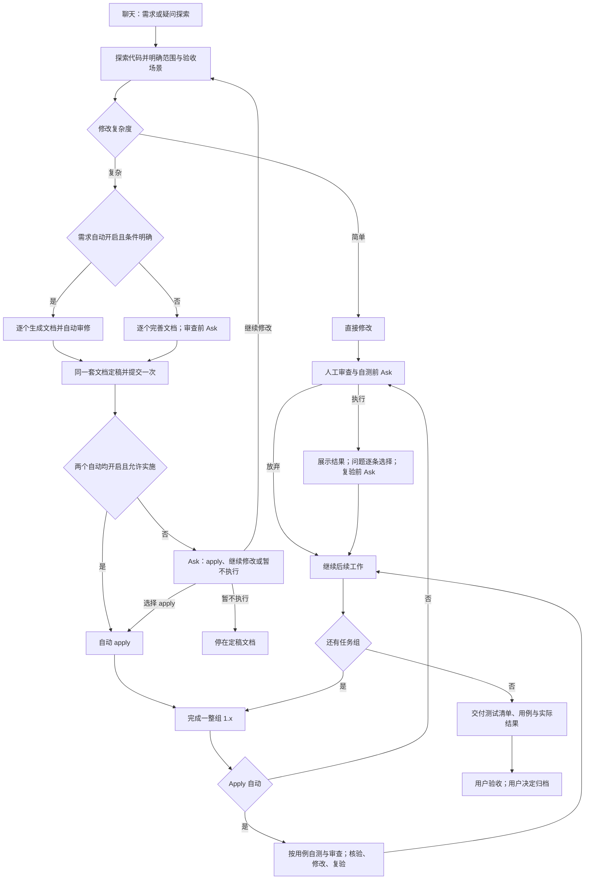
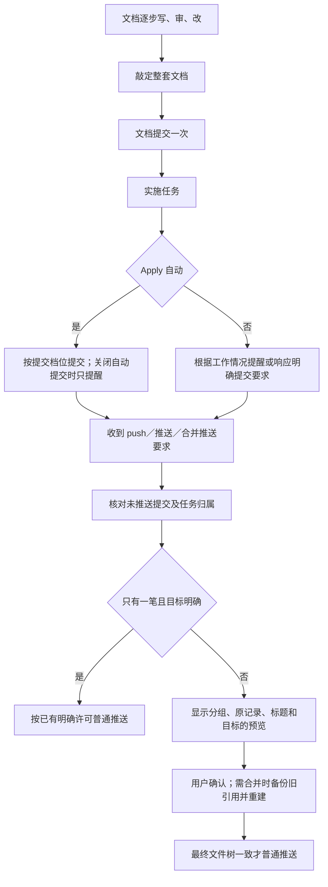

# 2026-10-14 流程调整与验收依据

本次包含 18:27 问题单的 #105、#110、#112—#117，以及随后确认的流程调整。数据库 #106—#109、#111 和 MiniMax 请求问题不处理。OpenSpec 不随包集成、不自动升级；指令不可用且确认版本较低时提示使用者升级。

换人或换会话继续开发，先看 [开发交接](handoff-20261015.md)：包含最终讨论决定、已提交与未提交范围、测试结果和待办。本文件保存本轮需求与验收依据，不代表实现已全部完成。

## 已确认规则

- 配置分全局、OpenSpec 需求模式、Apply 模式。两阶段各自自动开关、审查上限；本次安装与旧版升级关闭两自动开关，配置再次保存不重置。
- 探索先读实际情况。目标、范围、规则、验收仍有疑问必须沟通；开启需求自动不授权猜需求。确认具备自动条件后逐步生成 proposal、specs、design、tasks，各产物完成后审修，再继续。
- 人工模式审查、自测、复验前用 Ask；用户已经明确要求的操作直接执行。问题先完整展示，再逐条选推荐修改、不改或自行输入。选择放弃直接继续，不留下未审查、未测试、待办或反复提醒，也不记为通过。
- 自动模式自动核验、修改、复验。每个文档产物、每个完成的任务组（1.x、2.x）独立计数。批数、文件数不等于审查轮数；达到上限仍有问题不算通过。用户主动再次审查可执行。
- 同一套文档敲定后提交一次。两阶段均自动且没有只写需求的限制时自动进入 apply；其他组合用 Ask 提供 apply 选项。人工模式允许提醒提交。
- 文档不设 250 行硬上限；需要时画图。任一阶段变化，同步全部受影响需求、设计、任务、代码、用例、流程图，并添加修改批注和修订依据；仅受影响的旧审查和验证结论失效。
- tasks 保留项目交付任务，套件自启、审查执行、自测调度等放本机记录，不把套件内部信息写入团队产物。实际测试代码仍可作为交付任务。
- 需求阶段准备验收场景，设计阶段补前置条件、数据、步骤、预期。自测围绕这些用例；交付用例、实际结果和遗留问题，用户验收独立。
- 合并推送按任务或独立修复归组，保留需求定稿、验收、归档节点；只处理未推送历史，无可靠归属不合并。此机制不适用于本开发仓库。

## 执行流程

## 提交与推送

## 问题核对

| 编号 | 核对结论与处理目标 |
|---|---|
| #105 | 本机检查预算与前置联网拉取冲突；网络等待不消耗本机检查预算 |
| #110 | 通用验证证据的 Git 超时；缩小无关调用、保留失败诊断，不能把超时当验证成功；具体慢 Git 原因无现场证据 |
| #112 | 提案提交判断必须根据本次暂存文件；普通经验规则不套提案许可 |
| #113 | 材料选择、分段、空结果解析及覆盖报告；covered 为空不能证明请求没发出 |
| #114 | 分阶段、分审查点计数；材料批数与轮数分别展示 |
| #115 | 套件问题只报数量和可点击详情链接；实际影响交付的限制仍说明 |
| #116 | 独立批次失败保留诊断并继续可执行批次；区分超限、失败、未尝试；不能将反馈推测当已证实原因 |
| #117 | 团队产物只记需求、设计、实现事实；套件命令、钩子和预算留本机 |

## 验收用例（实现前建立）

通用前提：在假用户目录安装，使用临时项目和临时裸仓库，不连接真实数据库、不推真实远端。人工验收可在测试项目操作配置页和对话。

| 用例 | 步骤 | 预期 |
|---|---|---|
| F01 | 全新安装；再从已开启自动的旧版升级 | 两个自动均关闭；任务进度保留；后续手动开启、同步配置不再被重置 |
| F02 | 四种开关组合分别进入需求和 apply | 只当前阶段对应开关生效；双自动且文档定稿提交后可自动 apply |
| F03 | 开需求自动，提供缺少关键规则的需求 | 先探索并询问；未明确前不自动生成整套文档 |
| F04 | 逐步写 proposal、specs、design、tasks | 每个产物可独立审修；每点次数独立；文档超过 250 行可正常编辑 |
| F05 | 完成 1.1 但还有 1.2，再完成整个 1.x | 仅整个组完成后进入该组审查点；不必等所有组完成 |
| F06 | 人工模式完成文档或代码；选择放弃审查、自测 | 先 Ask；放弃后继续，不留未审/未测待办、不标通过、不催补做 |
| F07 | 人工选择审查，返回多个问题 | 先展示全部，再逐条选择；修改后复验先 Ask；主动再审不被自动上限拦截 |
| F08 | 自动模式审查发现问题直至上限 | 自动核验修改复验；提前通过停止；上限未解决不算通过 |
| F09 | 设计阶段改变一项需求 | 同步受影响产物、代码、用例、流程图和批注；只失效相关结果 |
| F10 | 检查 tasks 和 revisions，准备交付 | 无套件自启、调度、钩子预算等内部信息；验收用例实现前已有，交付可由未安装套件的同事执行 |
| F11 | 仅暂存经验规则，工作区另有提案 | 不误套提案提交检查；已有明确提交许可可执行 |
| F12 | 模拟慢拉取后读取会话及无关工具完成 | 本机预算不被网络耗尽；无关命令不额外收集验证 Git 证据 |
| F13 | 审查首批空回、后批正常，再全部材料超限 | 后批可继续；覆盖、失败、超限、未尝试准确；无材料时不调用模型 |
| F14 | 本轮有多条套件问题后收工 | 只显示数量与详情链接，交付主体不被问题表占据 |
| F15 | 同一变更包含不同任务及独立修复，预览合并推送 | 按任务或修复归组；定稿、验收、归档节点保留；不混入已推送提交 |
| F16 | 旧 OpenSpec 不支持所需指令 | 说明版本和升级方法，不自动安装升级 |
| F17 | 人工模式改代码；让它编译；再让它起服务或跑测试；另开一次说"把服务起起来" | 编译直接跑不问；起服务、跑测试先 Ask；说了"把服务起起来"直接起（2026-10-16 决定） |
| F18 | 人工模式一个要求里连着改几处，中途不跑编译；说不用审查；再提一个新要求并改代码 | 第一个要求只问一次，问里带"要不要跑快检"；说不用后同一要求不再问；新要求改了代码再问一次 |
| F19 | 人工模式任务都勾上、没审查，试着归档 | 不要求先审查；提示如实说"没有做过完整审查"，等你说归档 |

## 执行结果

| 检查 | 当前结果 |
|---|---|
| 反馈专项 | 18 项通过；旧版反例 12 项通过、6 项失败 |
| 两阶段工作流专项 | 最新 52 项通过；较早用例的旧版反例 15 项通过、10 项失败；新增用例尚未全部重跑旧版 |
| 首次基础回归 | 56 套，2995 项通过、105 项失败；正在修复实际缺陷和更新有意改变的旧预期 |
| 2026-10-16 基础回归（两份旧基线，无端到端、无查库） | 58 套，3651 项通过、0 项失败；接手时的 58 项失败和修了哪些缺陷见[开发交接](handoff-20261015.md) |
| 全量与压缩包安装升级 | 尚未完成，不作为已交付版本 |

套件自测不代替用户验收。发版前用最终结果更新本表，用户测试按 F01—F16 执行。
